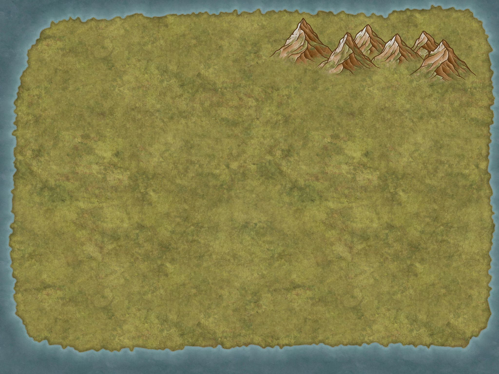
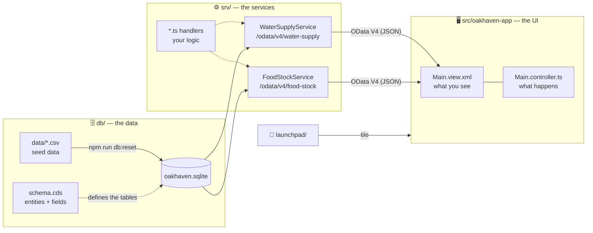

# 🏰 Oakhaven

**Hack The Future 2026 · SAP CAP + SAPUI5 (TypeScript)**

> *For as long as anyone can remember, Oakhaven ran on quiet little systems: water flowed from
> Silverbrook Spring to every house, the pantry knew what was on its shelves, and the village
> council never had to wonder.*
>
> *Then came **the Desync**. Overnight, the systems went dark. Screens, alerts, overviews — gone.
> Only the raw data survived, scattered across the pipes, the sensors and the pantry shelves.*
>
> *Four villagers need your help. You will meet them on the **HTF platform** — talk to them, find out
> what they really need, and build it.*

This repository is your starting point. It contains **the world** — the data model, the data that
survived and a small app that shows it — and **none of the features**. Those are up to you.



---

## 🗺️ Your mission

Four villagers need your help. Only they know what they need, so **ask first, build second**.

| | Villager | Their problem, in one line |
| --- | --- | --- |
| 💧 | **Maren Holt**, water keeper | "I'm always too late. Help me know where to go first." |
| 🍞 | **Tobin Reyes**, baker | "I want to know before it goes wrong, not after." |
| 🏛️ | **Rowan Ashby**, chair of the village council | "We want to see at a glance how Oakhaven is doing." |
| 🔍 | **Ilse Vermeer**, librarian | "Somebody tampered with our data. I want to see what changed." |

### Your plan in five steps

No clock: every team goes at its own pace. The platform shows which step you are on.

1. **Get this app running**: `docker compose up --build --watch`, then follow
   [Your first 30 minutes](GETTING-STARTED.md#your-first-30-minutes).
2. **Ask first**: open the **HTF platform** → *Challenges* → *Crisis in Oakhaven*.
   Every villager has a chat. Meet all four before you build. You get a limited number of
   questions per villager, and **a vague question gets a vague answer**.
3. **Build**: build a solution for every villager in this repo. One app or four, your call.
4. **Hand in and call a coach**: done with a villager? Hand in 5 to 10 sentences on the platform
   (what you built, for which need, which choices you made and what you left out on purpose),
   then **call a coach** and show it in about two minutes.
5. **The Oakhaven Fair**: all four handed in? The finale opens on the platform: one extra, agreed
   with a coach. Every team wins a prize.

### The rules that matter

- **The villagers are your requirements.** This repo and the platform briefs on purpose don't say
  what to build. Your own AI assistant can help you build, but it can't know what the villagers
  need. Only they can tell you.
- **One app or four, your call.** Build one app for the whole village, or one per villager.
  Every app you add under `src/` gets its own launchpad tile ([recipe](#add-a-new-ui5-app-with-its-own-launchpad-tile)).
- **We judge the solution, not the code.** Per villager: *asked well* 2 · *logical* 4 ·
  *creative* 4 points. Anything goes, as long as you can explain why.
- **The data is the village after the Desync.** Not everything in it is right, and that is part
  of the story.

---

## 🚀 Quick start

You only need **Docker** (and Git + VS Code). Full step-by-step guide: **[GETTING-STARTED.md](GETTING-STARTED.md)**.

```bash
git clone <repository-url> oakhaven
cd oakhaven
docker compose up --build --watch
```

Wait for `server listening on { url: 'http://localhost:4004' }`, then open:

| URL                                                    | What you get                                    |
| ------------------------------------------------------ | ----------------------------------------------- |
| **http://localhost:4004/launchpad/index.html**   | The Oakhaven launchpad — one tile per app      |
| http://localhost:4004/app/oakhaven/index.html          | The Oakhaven app on its own                     |
| http://localhost:4004/odata/v4/water-supply/WaterPipes | Raw pipe data as JSON                           |
| http://localhost:4004/odata/v4/food-stock/StockItems   | Raw stock data as JSON                          |
| http://localhost:4004                                  | CAP's start page: every service, entity and app |

---

## 🧭 Oakhaven in 10 minutes

### The big picture

Three layers, three folders. Data flows from left to right; you can change every box.



- **`db/`** — *what exists.* `schema.cds` describes the entities (tables) in CDS, SAP's modelling
  language. The CSV files in `db/data/` are loaded into a SQLite database when it is created.
- **`srv/`** — *what is exposed.* A `.cds` file declares a service: which entities are reachable
  over OData, and under which URL. CAP serves them **without any code** — reading, filtering,
  sorting, paging and `$expand` all work out of the box. A `.ts` file next to it adds custom logic.
- **`src/`** — *what users see.* Every folder with a `ui5.yaml` is a SAPUI5 app. Its views bind
  straight to the OData services, so a table shows rows without a single line of loading code.

### Where everything lives

```text
oakhaven/
├── db/
│   ├── schema.cds                  the data model (all entities)
│   └── data/*.csv                  seed data — file name = <namespace>-<Entity>.csv
├── srv/
│   ├── water-supply-service.cds    WaterSupplyService → /odata/v4/water-supply
│   ├── water-supply-service.ts     its handlers  (👋 contains the worked example)
│   ├── food-stock-service.cds      FoodStockService   → /odata/v4/food-stock
│   ├── food-stock-service.ts       its handlers  (empty — yours to fill)
│   ├── server.ts                   server bootstrap: builds the launchpad tiles
│   └── lib/                        helpers (demo sensor feed, icon font, …)
├── src/
│   └── oakhaven-app/               the Oakhaven app (SAPUI5, TypeScript)
│       ├── ui5.yaml                app config — mountPath = its URL (/app/oakhaven)
│       └── webapp/
│           ├── manifest.json       app descriptor: id, OData models, launchpad tile
│           ├── Component.ts        app start-up
│           ├── view/Main.view.xml  the page (XML)
│           ├── controller/Main.controller.ts   the page logic (TypeScript)
│           ├── i18n/i18n.properties            all texts
│           ├── css/style.css       small style tweaks
│           └── img/oakhaven-map.jpg            the village map
├── launchpad/                      the local Fiori launchpad (not an app — just shows the tiles)
├── AGENTS.md                       project guide for your AI assistant
├── GETTING-STARTED.md              install, run, troubleshoot
├── Dockerfile · docker-compose.yml · .devcontainer/   the dev environment
└── package.json                    npm scripts + dependencies
```

### How data flows

1. On first start, the container runs `npm run db:reset`: it creates `db/oakhaven.sqlite` from
   `schema.cds` and fills it with the CSV files.
2. The browser opens the app. UI5 reads `manifest.json` and creates two **OData V4 models**: the
   default model talks to `/odata/v4/water-supply/`, the `food` model to `/odata/v4/food-stock/`.
3. A table in `Main.view.xml` binds `items="{/WaterPipes}"`. UI5 sends
   `GET /odata/v4/water-supply/WaterPipes?$select=pipeID,location,…` — only the fields the view uses.
4. CAP turns that into SQL, runs it, and — if you registered one — calls your **handler** in
   `srv/*.ts` before it returns the JSON.
5. UI5 renders one row per entry. Done — no glue code.

> 💡 Open the browser's **DevTools → Network** tab and filter on `odata` to watch this happen.
> You can paste any of these URLs straight into the address bar too, e.g.
> `/odata/v4/water-supply/WaterPipes?$expand=sensors,repairs`.

### The data model

All entities live in the namespace `oakhaven.curse` (`db/schema.cds`). Every entity also has:

| Field                                                        | Meaning                                                                                                       |
| ------------------------------------------------------------ | ------------------------------------------------------------------------------------------------------------- |
| `ID`                                                       | technical key (UUID), from CAP's `cuid` aspect                                                              |
| `createdAt`, `createdBy`, `modifiedAt`, `modifiedBy` | when and by whom the row was created / last changed — CAP's `managed` aspect fills these in on every write |

#### 💧 WaterPipes — the pipe network · `/odata/v4/water-supply/WaterPipes`

| Field                        | Unit       | Meaning                                                              |
| ---------------------------- | ---------- | -------------------------------------------------------------------- |
| `pipeID`                   |            | Name of the pipe, e.g. `PRIMARY-MAIN`, `NORTH-BRANCH-02`         |
| `location`                 |            | Route label, e.g. `Silverbrook Spring → Central Market Square`    |
| `startPoint`, `endPoint` |            | Landmark names the pipe runs between, in flow direction              |
| `pipelineType`             |            | `mainLine`, `branch` or `secondary`                            |
| `diameter`                 | mm         | Inner diameter                                                       |
| `length`                   | m          | Length of the pipe                                                   |
| `nominalFlowRate`          | L/min      | What the pipe carries at full capacity                               |
| `currentFlowRate`          | L/min      | What it carries right now                                            |
| `currentPressure`          | PSI        | Water pressure right now                                             |
| `lastMaintenance`          | date-time  | When the pipe was last maintained                                    |
| `mapPath`                  | grid units | The pipe's route on the village map — see *The village map* below |
| `sensors`, `repairs`     |            | The pipe's sensors and repairs (compositions — use `$expand`)     |

#### 📟 Sensors — measuring points on the pipes · `/odata/v4/water-supply/Sensors`

| Field           | Unit      | Meaning                                                                  |
| --------------- | --------- | ------------------------------------------------------------------------ |
| `sensorID`    |           | e.g. `SENS-001`                                                        |
| `pipe`        |           | The pipe it is mounted on (association → `pipe_ID`; `$expand=pipe`) |
| `flowRate`    | L/min     | Flow the sensor measures                                                 |
| `pressure`    | PSI       | Pressure the sensor measures                                             |
| `lastReading` | date-time | When the sensor last reported                                            |

> The demo sensor feed (`srv/lib/demo-freshness.ts`) plays the role of the real sensors: while the
> server runs, it sets `lastReading` of every sensor to "now" every 20 seconds.

#### 🔧 Repairs — the repair log · `/odata/v4/water-supply/Repairs`

| Field          | Meaning                                        |
| -------------- | ---------------------------------------------- |
| `pipe`       | The repaired pipe (association → `pipe_ID`) |
| `repairID`   | Repair number (UUID)                           |
| `issue`      | What was done                                  |
| `repairDate` | When it was done (date-time)                   |
| `repairedBy` | Who did it                                     |

#### 📍 Landmarks — places in the village · `/odata/v4/water-supply/Landmarks`

| Field          | Meaning                                                                                        |
| -------------- | ---------------------------------------------------------------------------------------------- |
| `name`       | e.g. `Silverbrook Spring`, `The Bakery`                                                    |
| `kind`       | `spring`, `mill`, `market`, `inn`, `residential`, `bakery`, `farm` or `forest` |
| `gridCell`   | Cell on the village map, `A1` … `H8`                                                      |
| `suppliedBy` | `pipeID` of the pipe that feeds this place (only for residential, bakery and farm)           |

#### 🧺 StockItems — the village pantry · `/odata/v4/food-stock/StockItems`

| Field               | Unit           | Meaning                                                                     |
| ------------------- | -------------- | --------------------------------------------------------------------------- |
| `itemID`          |                | Code, e.g. `MILK`, `FLOUR`                                              |
| `name`            |                | Display name                                                                |
| `unit`            |                | Unit of every quantity of this item: `KG`, `L`, `Dozen` or `Number` |
| `icon`            |                | Icon URI, e.g. `sap-icon://ti/milk` (use it in a `core:Icon`)           |
| `currentQuantity` | `unit`       | What is on the shelf right now                                              |
| `minStockLevel`   | `unit`       | The level the village wants to stay above                                   |
| `consumptionRate` | `unit` / day | How much the village uses per day                                           |
| `receivals`       |                | Deliveries of this item (composition → `StockReceivals`)                 |

#### 📦 StockReceivals — deliveries · `/odata/v4/food-stock/StockReceivals` *(empty)*

| Field                | Meaning                                         |
| -------------------- | ----------------------------------------------- |
| `item`             | The delivered item (association → `item_ID`) |
| `quantityReceived` | Amount delivered, in the item's `unit`        |
| `supplier`         | Who delivered it                                |
| `receivedAt`       | When it arrived (date-time)                     |

#### 🔔 Notifications — messages about stock items · `/odata/v4/food-stock/Notifications` *(empty)*

| Field            | Meaning                                                    |
| ---------------- | ---------------------------------------------------------- |
| `item`         | The item the message is about (association → `item_ID`) |
| `message`      | The text                                                   |
| `acknowledged` | `true` once somebody has read it                         |

### 🗺️ The village map

`src/oakhaven-app/webapp/img/oakhaven-map.jpg` is a painted map of Oakhaven, **2048 × 1536 px**,
with a chess-board grid of **8 × 8 cells**: columns **A–H** run west → east, rows **1–8** run
south → north (row 8 is the top of the image). The grid does not cover the whole image — it sits
on the land inside the sea border:

```ts
const IMAGE = { width: 2048, height: 1536 };
const GRID_BOUNDS = { x: 150, y: 120, width: 1750, height: 1280 }; // px — top-left corner + size of the 8×8 board
```

Two fields use this grid:

- **`Landmarks.gridCell`** — a cell name like `G7` (Silverbrook Spring) or `A3` (The Bakery).
- **`WaterPipes.mapPath`** — a list of points `"x,y x,y …"` in **grid units**: `x` and `y` go from
  `0` to `8`, measured from the **south-west corner of cell A1**, in flow direction. One unit is
  one cell, so the centre of cell `E6` is `4.5,5.5`.

From grid units to image pixels (note the flipped `y`: images count from the top):

```ts
const CELL_WIDTH = GRID_BOUNDS.width / 8;   // 218.75 px
const CELL_HEIGHT = GRID_BOUNDS.height / 8; // 160 px

function toPixel(x: number, y: number): { x: number; y: number } {
  return {
    x: GRID_BOUNDS.x + x * CELL_WIDTH,
    y: GRID_BOUNDS.y + (8 - y) * CELL_HEIGHT,
  };
}
// Centre of a cell: "E6" → column index 4 (A=0) + 0.5, row 6 - 0.5 → toPixel(4.5, 5.5)
```

In an app, load the image with `sap.ui.require.toUrl("oakhaven/village/img/oakhaven-map.jpg")`
(see `Main.controller.ts`) so it also works inside the launchpad.

---

## 👋 From question to screen — the worked example

There is exactly **one** piece of custom logic in this repository, and it is there to be copied.
Search the code for **`👋 EXAMPLE`** to find every place it touches.

**The question:** *"How many days ago was each pipe last maintained?"*
The database only stores `lastMaintenance` (a date). The number of days changes every day, so we do
not store it — we **compute it on every read**.

**1 · Declare the field in the service** — `srv/water-supply-service.cds`

```cds
entity WaterPipes as projection on db.WaterPipes {
  *,
  virtual null as daysSinceMaintenance : Integer
};
```

`virtual` means: part of the API, not a column in the database. CAP returns it as `null` unless a
handler fills it in.

**2 · Fill it in after every READ** — `srv/water-supply-service.ts`

```ts
this.after('READ', 'WaterPipes', addDaysSinceMaintenance);
```

The handler receives the rows CAP is about to return and sets `daysSinceMaintenance` on each of
them. One subtle point: a client may ask for **only some fields**
(`$select=pipeID,daysSinceMaintenance`) — and UI5 always does that. Then `lastMaintenance` is not in
the row, so the handler reads the missing values from the database in **one** extra query. Read the
comments in the handler — it is the pattern for every computed field.

**3 · Show it** — `src/oakhaven-app/webapp/view/Main.view.xml`

```xml
<ObjectNumber number="{daysSinceMaintenance}" unit="{i18n>unitDays}" />
```

plus a `<Column>` header and the i18n texts. Refresh the browser — done.

**Try it:**
[`/odata/v4/water-supply/WaterPipes?$select=pipeID,daysSinceMaintenance`](http://localhost:4004/odata/v4/water-supply/WaterPipes?$select=pipeID,daysSinceMaintenance)

---

## 🧑‍🍳 Recipes

> **Inside Docker:** run every `npm …` command as `docker compose exec app npm …` (plain Docker),
> or just `npm …` in the VS Code Dev Container terminal.

### Add a field

1. Add it to the entity in `db/schema.cds`, e.g. in `StockItems`: `supplier : String;`
2. *(Optional)* add a `supplier` column to `db/data/oakhaven.curse-StockItems.csv`.
3. Rebuild the database: `npm run db:reset`.
4. The service projections expose every field (`projection on db.StockItems`), so it is already
   in the API. Bind it in a view: `<Text text="{food>supplier}" />` and refresh the browser.

### Add a computed field

Copy the worked example: a `virtual` element in the service `.cds`, an `after('READ')` handler in
the service `.ts`, a column in the view. Keep the `$select` re-read — without it the field is
`null` whenever the client did not ask for its inputs.

### Add an action that writes data

An **action** is an operation a client can call — the place for changes with rules. A *bound*
action belongs to one entity instance. Example: rename a landmark.

**1 · Declare it** — `srv/water-supply-service.cds`

```cds
@readonly
entity Landmarks as projection on db.Landmarks actions {
  /** Gives the landmark a new name. */
  action rename(newName : String) returns Landmarks;
};
```

`@readonly` blocks generic writes (`PATCH`, `POST`, `DELETE`); your action still can change data.

**2 · Implement it** — `srv/water-supply-service.ts`, inside `init()` (before `return super.init()`):

```ts
this.on('rename', 'Landmarks', async (req: ActionRequest) => {
  const newName = req.data.newName?.trim();
  if (!newName) return req.error(400, 'A landmark needs a name', 'newName');
  await UPDATE(req.subject).with({ name: newName });  // req.subject = the landmark the action was called on
  return SELECT.one.from(req.subject);                 // return the updated landmark
});
```

and describe the bits of the CAP API it uses at the top of the file (the existing interfaces grow a little):

```ts
interface ActionRequest {
  readonly data: { readonly newName?: string };          // the action parameters
  readonly subject: unknown;                             // reference to the bound landmark
  error(code: number, message: string, target?: string): void;
}

interface CdsService {
  // …existing members…
  on(event: string, entity: string, handler: (req: ActionRequest) => unknown): void;
}

interface CdsApi {
  readonly ApplicationService: new (...args: readonly never[]) => CdsService;
  readonly ql: {
    readonly SELECT: {
      // …existing from(...)…
      readonly one: { from(target: unknown): PromiseLike<unknown> };
    };
    UPDATE(target: unknown): { with(data: Readonly<Record<string, unknown>>): PromiseLike<unknown> };
  };
}

const { SELECT, UPDATE } = cds.ql;
```

Because `Landmarks` is `managed`, CAP sets `modifiedAt` / `modifiedBy` for you.

**3 · Try it** without a UI — with `curl`, or the REST Client extension in VS Code:

```http
POST http://localhost:4004/odata/v4/water-supply/Landmarks(40000000-0000-4000-8000-000000000004)/WaterSupplyService.rename
Content-Type: application/json

{ "newName": "The Shepherd's Rest" }
```

**4 · Call it from UI5** — e.g. from a button inside a table row (OData V4 model):

```ts
import type { Button$PressEvent } from "sap/m/Button";
import type Context from "sap/ui/model/odata/v4/Context";
import type ODataContextBinding from "sap/ui/model/odata/v4/ODataContextBinding";

// in your controller class:
public async onRenamePress(event: Button$PressEvent): Promise<void> {
  const context = event.getSource().getBindingContext() as Context;   // the row's landmark
  const action = context.getModel().bindContext("WaterSupplyService.rename(...)", context) as ODataContextBinding;
  action.setParameter("newName", "The Shepherd's Rest");
  await action.invoke();   // POST …/Landmarks(<ID>)/WaterSupplyService.rename
  context.refresh();       // re-read the row so the table shows the new name
}
```

### Add a new UI5 app with its own launchpad tile

1. Copy the folder `src/oakhaven-app` to `src/<your-app>` (e.g. `src/water-app`).
2. In the copy, replace the app id everywhere:
   - `oakhaven.village` → `oakhaven.waterapp` (in `ui5.yaml`, `manifest.json`, `index.html`,
     `Component.ts`, views, controllers — the `@namespace` comments too!)
   - `oakhaven/village` → `oakhaven/waterapp` (module paths)
3. In `ui5.yaml` set a new `mountPath`, e.g. `/app/water`.
4. In `manifest.json` → `sap.app.crossNavigation.inbounds.display` set a new `semanticObject`
   (one word, e.g. `WaterApp`), and pick an `icon` (`sap-icon://…` from the
   [SAP icon explorer](https://ui5.sap.com/test-resources/sap/m/demokit/iconExplorer/webapp/index.html),
   or `sap-icon://ti/<name>` from [Tabler icons](https://tabler.io/icons)). Title and subtitle come
   from `appTitle` / `appDescription` in its i18n file.
5. Restart so the server picks up the new app: `docker compose up --build --watch`
   (Dev Container: `F1` → *Dev Containers: Rebuild Container*).
6. Reload the launchpad — your tile is there. (`srv/server.ts` builds a tile for every app under `src/`.)

Keep the apps you do not need, or delete them — there is nothing to unregister.

### Reset the database

```bash
npm run db:reset                         # Dev Container terminal
docker compose exec app npm run db:reset # plain Docker
```

Drops `db/oakhaven.sqlite` and rebuilds it from `schema.cds` + `db/data/*.csv`. Run it after every
change to the schema or the CSV files, and whenever you want the original data back. The running
server picks up the fresh database — refresh the browser.

---

## 🛠️ Commands

| Command                               | What it does                                                                                               |
| ------------------------------------- | ---------------------------------------------------------------------------------------------------------- |
| `docker compose up --build --watch` | Build the image and start everything; restarts the server when `srv/`, `db/` or `.cdsrc.json` change |
| `npm run db:reset`                  | Rebuild the database from the schema and the CSV seed data                                                 |
| `npm run typecheck`                 | Check all TypeScript (backend + apps) for errors                                                           |
| `npm run lint:ui5`                  | UI5 linter for every app under `src/`                                                                    |
| `npm run build`                     | `cds build` — compile the model into `gen/`                                                           |
| `npm run watch`                     | `cds watch` — the dev server (the container already runs it)                                            |

---

## 📚 Learn more

- **CAP** — [capire](https://cap.cloud.sap/docs/): [CDS modelling](https://cap.cloud.sap/docs/cds/cdl),
  [providing services](https://cap.cloud.sap/docs/guides/providing-services),
  [event handlers](https://cap.cloud.sap/docs/node.js/core-services#srv-on-before-after),
  [CQL queries](https://cap.cloud.sap/docs/node.js/cds-ql)
- **SAPUI5** — [SDK &amp; API reference](https://ui5.sap.com/), [control samples](https://ui5.sap.com/#/controls),
  [UI5 &amp; TypeScript](https://sap.github.io/ui5-typescript/), [OData V4 model](https://ui5.sap.com/#/topic/5de13cf4dd1f4a3480f7e2eaaee3f5b8)
- **Design** — [SAP Fiori design guidelines](https://www.sap.com/design-system/fiori-design-web/)
- **Your AI assistant** — point it at [AGENTS.md](AGENTS.md); it knows this repo's conventions.
